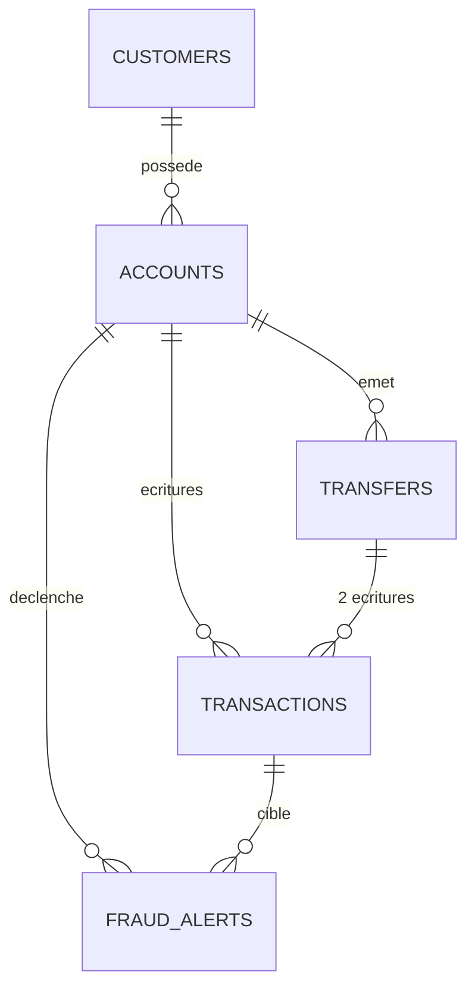

# NovaBank Core

Base de données PostgreSQL 18 d'une banque en ligne (projet seul, module SQL avancé et administration PostgreSQL, Ynov Bachelor 2). Elle rend impossibles trois problèmes du prototype : export des emails par un employé (droits), solde négatif par virements simultanés (transactions et verrous), historique lent (index).

## Environnement
VM Ubuntu Server (VMware), 2 cartes réseau (NAT + réseau privé hôte `192.168.100.10`), SSH par clé, PostgreSQL 18, Bash.

## Refaire tout depuis zéro
```bash
git clone git@github.com:TON_PSEUDO/novabank.git && cd novabank
sudo bash 01_install_serveur.sh      # installe PostgreSQL, pg_hba.conf, ufw (relançable)
sudo bash refaire_tout.sh            # supprime puis rejoue 00_ à 08_, mots de passe, tests
sudo bash sauvegarde.sh              # pg_dump -Fc, pg_restore dans une base temporaire, comptages
```
Aucun mot de passe n'est dans le dépôt : ils sont saisis à l'exécution (`\password`).

## Fichiers
| Fichier | Rôle |
|---|---|
| `01_install_serveur.sh` | E1 : installation, réglages, `pg_hba.conf`, `ufw` |
| `00_roles_db.sql` | E2 : rôle `bank_owner`, base `bankdb` (lancé par `postgres`) |
| `01_tables.sql` | E2 : schémas `core` et `audit`, types, 6 tables, contraintes |
| `02_donnees.sql` | E2 : 10 000 clients, 15 000 comptes, 250 000 virements, 1 000 000 d'écritures |
| `03_controle.sql` | E2 : requêtes de cohérence (0 ligne attendue) |
| `04_droits.sql` | E3 : 4 profils, `GRANT`/`REVOKE`, matrice de preuve |
| `05_vues.sql` | E4 : vue masquée, vue modifiable (`CHECK OPTION`), vue matérialisée |
| `06a_mesures.sql`, `06b_index.sql` | E5 : mesures `EXPLAIN` et 4 index |
| `07_triggers.sql` | E6 : solde, grand livre immuable, 2 écritures, fraude, audit |
| `08_procedures.sql` | E7 : `sp_virement`, `sp_ouvrir_compte`, `sp_releve` |
| `90_tests.sql`, `91_tests_base.sql` | E8 : tests (un qui passe, un refusé par règle) |
| `refaire_tout.sh`, `sauvegarde.sh` | E8 : reconstruction et sauvegarde vérifiée |

## Schéma

Tables : `core.customers`, `core.accounts`, `core.transfers`, `core.transactions`, `core.fraud_alerts`, `audit.audit_log`.

## Droits
| Profil | Compte | Droits |
|---|---|---|
| Propriétaire | `bank_owner` | Propriétaire des objets. Connexion depuis la VM seulement. |
| Appli | `bank_app` | Aucun droit sur les tables. `EXECUTE` sur les 3 procédures. Connexion depuis la VM seulement. |
| Analyste | `analyste_1` (groupe `grp_analyste`) | Lecture des comptes, virements, écritures, alertes. Sur `customers`, seulement les colonnes non personnelles. Timeout 60 s. |
| Support | `support_1` (groupe `grp_support`) | Aucun droit sur les tables. Vue masquée en lecture, vue des comptes avec `UPDATE (status)` sans passer à `CLOSED`. Timeout 10 s. |
| Auditeur | `auditeur_1` (groupe `grp_auditeur`) | Lecture seule des écritures, virements, alertes et du journal d'audit. |

`pg_hba.conf` : `postgres` par socket (`peer`), propriétaire et appli depuis la VM, les 3 groupes depuis `192.168.100.0/24`, tout le reste est refusé.

## Choix de conception
- Les règles qui ne regardent qu'une ligne sont des `CHECK` (montant positif, comptes différents, client majeur, solde ≥ 0). Celles qui regardent d'autres lignes sont des triggers (solde, 2 écritures par virement, fraude).
- Le solde est lu avec `SELECT ... FOR UPDATE` : deux opérations simultanées sur un compte s'attendent au lieu de lire le même solde.
- `sp_virement` verrouille les deux comptes dans l'ordre de leurs identifiants : pas d'interblocage.
- Grand livre immuable : triggers sur `UPDATE`, `DELETE` (par ligne) et `TRUNCATE` (par instruction).
- Le million d'écritures est chargé avant les triggers. Le dépôt d'ouverture de chaque compte vaut le total de ses débits plus un extra : le solde ne peut jamais être négatif.

## Mesures (E5), avant puis après les index
| Requête | Avant | Après | Index |
|---|---|---|---|
| Relevé d'un compte | 35 ms | 0,41 ms | B-tree `(account_id, created_at DESC)` |
| Recherche d'email | 4,7 ms | 0,044 ms | `lower(email)` |
| Gros retraits | 58 ms | 1,4 ms | partiel (`WHERE`) |
| Somme d'un mois | 44 ms | 8,4 ms | BRIN sur `created_at` |

Taille : le B-tree fait 30 Mo, le BRIN 24 ko. Un index sur `tx_type` (4 valeurs) est inutile : 81 ms avec l'index, 74 ms sans.

## Limites connues
- L'historique chargé avant les triggers n'a pas d'alertes de fraude.
- `BURST_TRANSFERS` crée une alerte par virement à partir du 5e en 10 minutes.
- Un superutilisateur peut désactiver les triggers.

## Captures
Dossier `captures/` : (à compléter : liste des fichiers, une ligne par capture).

## Utilisation d'une IA
J'ai utilisé Claude (Anthropic) comme assistant. Je lui ai demandé : de m'aider à configurer le réseau de la VM, SSH et Git ; d'écrire le script d'installation (E1) ; de proposer les types et contraintes des tables (E2) ; d'écrire la génération du million d'écritures ; les droits, vues, index, triggers et procédures (E3 à E7) ; les fichiers de tests, `refaire_tout.sh`, `sauvegarde.sh` et ce README. J'ai exécuté tous les scripts et je sais expliquer chaque ligne. Deux corrections ont été faites après essai : l'index « inutile » (il faut lire une autre colonne que `tx_type`) et le test du `TRUNCATE` (il faut tronquer aussi `fraud_alerts`).
